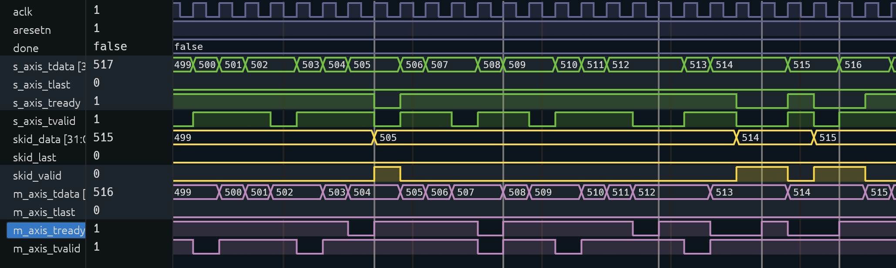
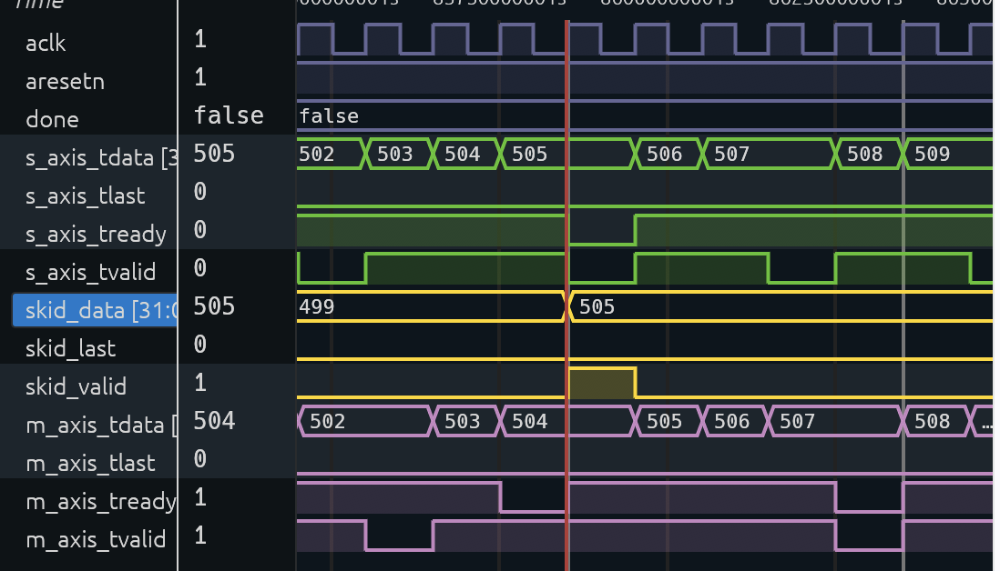

# Testbench `axis_reg_slice_tb`

Self-checking testbench for the [`axis_reg_slice`](axis_reg_slice.md) skid buffer: [`ip/axis_reg_slice/sim/vhdl/axis_reg_slice_tb.vhd`](../ip/axis_reg_slice/sim/vhdl/axis_reg_slice_tb.vhd).

```sh
scripts/run_sims.sh axis_reg_slice
gtkwave build/sim/axis_reg_slice/axis_reg_slice_tb.ghw
```

## What it proves

The source sends the beats 0, 1, 2, … 999, with `TLAST` on the last one. The checker requires that exactly those beats come out of the slice **in order, with nothing lost, duplicated or changed**, and `TLAST` only on beat 999. Random gaps on the input and random backpressure on the output force the skid buffer to fill and drain many times during the run. (For what a "beat" is, see [axi_stream_terms.md](axi_stream_terms.md).)

## Structure

The testbench is five processes. Each one has a single job:

| Process | Role |
|---|---|
| `reset_proc` | Holds `aresetn` low for 5 clock cycles, then releases it. |
| `source_proc` | Upstream block. Drives `s_axis_*` with beats 0 … `NUM_BEATS-1` and inserts random gaps. |
| `sink_proc` | Downstream block. Drives `m_axis_tready` randomly. |
| `checker_proc` | Watches `m_axis_*` and compares every beat with what it expects. |
| `control_proc` | Ends the simulation: PASS when the checker has seen every beat, FAIL after a 100 µs watchdog timeout. |

### Source

Each loop iteration does three things:

1. Put beat `i` on the bus (`tdata`, `tvalid = '1'`, `tlast` on the last beat).
2. Wait for a rising edge.
3. Check whether the beat transferred on that edge (`tvalid = '1'` and `tready = '1'`). If it did, go to `i + 1`. If not, the next iteration drives the same beat again, so it stays on the bus.

After a transfer, it inserts random idle cycles (`tvalid = '0'`): with 30 % probability one idle cycle, then another roll, and so on, about 0.43 idle cycles per beat on average. Gaps go only right after a transfer, because the AXI rules say that once `tvalid` is high it must stay high, with the same data, until the beat transfers.

The source also never waits for `tready` before raising `tvalid`. That is the other AXI source rule; breaking it can deadlock two blocks that each wait for the other.

### Sink

Every cycle `m_axis_tready` is `'1'` with 70 % probability. A sink may change `tready` whenever it likes, so there are no rules to respect here.

### Checker

On every rising edge where `m_axis_tvalid = '1'` and `m_axis_tready = '1'`, it asserts that:

- `m_axis_tdata` equals the expected counter `i`
- `m_axis_tlast` is `'1'` exactly when `i = NUM_BEATS - 1`

Then it increments `i`. After `NUM_BEATS` beats it sets `done`. A mismatch prints the beat number and the value it got, for example `beat 4: got tdata 0x00000005`.

The checker samples in a clocked process (`process (aclk)` + `rising_edge`). It sees the values the signals had at the edge, before any flop updated them in the same time step.

### Randomness

`uniform(seed1, seed2, r)` from `ieee.math_real` returns a pseudo-random `r` between 0 and 1 and updates the seeds. The same seeds give the same sequence on every run, so a failure always reproduces. The source and sink use different seeds so that their patterns are independent. Change the seeds to explore new patterns.

## Reading the waveform



Signals from top: clock, reset, `done`; the input side `s_axis_*` (green); the slice's internal skid registers (yellow); the output side `m_axis_*` (pink).

- **Normal flow (left, beats 499–504):** the skid is empty, so `s_axis_tready` stays high. Each beat appears on `m_axis_tdata` one clock after it was accepted on `s_axis_tdata`: the slice's one cycle of latency.
- **Input gaps:** `s_axis_tvalid` drops between some beats. `s_axis_tdata` keeps its old value during a gap; that's fine, because data is ignored while `tvalid` is low.
- **A skid event (beat 505):** the sink drops `m_axis_tready` for one cycle while 504 sits on the output. On that edge the output can't move, but `s_axis_tready` was still high, so the source hands over 505. The slice parks it in the skid (`skid_valid` goes high, `skid_data = 505`), and `s_axis_tready` drops for the next cycle. When the sink is ready again, 504 leaves and 505 moves from the skid to the output. Nothing is lost.
- **Two more skid events (beats 514 and 515)** show the same thing on the right: every time `skid_valid` is high, `s_axis_tready` is low, and the output keeps going 513, 514, 515 in order.

### Why everything changes exactly on the clock edge

RTL simulation has zero delay. A real flop's output changes slightly after the edge (clock-to-Q delay, a fraction of a nanosecond), but the simulator updates it at the same time as the edge. Order is kept by **delta cycles**: steps that happen at the same simulated time, one after another.

```
t = 1000 ns, delta 0:  aclk goes 0 → 1
t = 1000 ns, delta 1:  every process waiting on the edge runs and reads the OLD values
t = 1000 ns, delta 2:  the new values appear
```

The viewer shows only time, not deltas, so sampling and updating look simultaneous. In the simulator, sampling always comes first.

**Reading rule: at each rising edge, the values just to the left of the edge are what got sampled. The values to the right are the results.**

### Trap: the value column shows values *after* the edge



With the cursor exactly on this edge, the value column says `s_axis_tvalid = 0` and `s_axis_tready = 0`, yet `skid_valid = 1` and `skid_data = 505`. It looks as if 505 was captured without a handshake. Reading left of the edge shows what really happened:

| Signal | Just left of the cursor (sampled) | Value column (after the edge) |
|---|---|---|
| `s_axis_tvalid` | **1** | 0, the source starts a gap |
| `s_axis_tready` | **1** | 0, the skid is now full |
| `s_axis_tdata` | 505 | 505 |
| `m_axis_tvalid` | 1 (504 on the output) | 1 |
| `m_axis_tready` | **0**, the sink stalls | 1, a new random value |

1. **Cursor edge:** the output is stalled, so 504 stays. But 505 transfers on the input, because `s_axis_tready` comes from a flop and was still `1`. It is parked in the skid, and `s_axis_tready` drops.
2. **Next edge:** the sink is ready, so 504 leaves and 505 moves from the skid to the output. `skid_valid` clears, `s_axis_tready` rises, and the source puts up 506.

Without the skid, beat 505 would have been lost here.

**GTKWave tip:** to read sampled values in the value column, put the cursor a little left of an edge, not exactly on it.

## Testing the test

A testbench is only useful if it fails when the design is wrong. Each bug below was put into a copy of the DUT, and the testbench caught every one:

| Bug | Reported as |
|---|---|
| `m_axis_tlast` never set | `beat 999: got tlast '0'` |
| `s_axis_tready` always `'1'`, ignoring a full skid | `beat 4: got tdata 0x00000005` (lost beat) |
| Skid never drained | `beat 4: got tdata 0x00000003` (duplicated beat) |
| Skid never captures | `beat 3: got tdata 0x00000004` (lost beat) |
| Output overwritten during a stall | `beat 1: got tdata 0x00000003` |

## Not covered yet

**Throughput.** The skid buffer exists so the slice can run at one beat per clock while the sink is always ready. A slice that only accepts every other beat (for example `s_axis_tready <= not (skid_valid or m_valid)`) still passes this testbench, because nothing measures speed.
