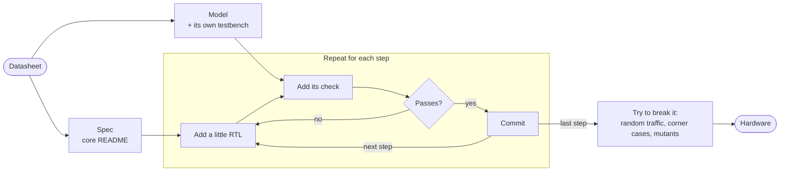

# How a core gets built

The RTL and its testbench grow **together, in small steps**. If the whole design is written first, the first failing simulation could be caused by anything. If each piece is tested as it's added, the bug is almost always in the lines just written.

## Two kinds of testing

| | Quick checks while building | Verification at the end |
|---|---|---|
| **Question** | Does what I just wrote work? | Can I break it? |
| **Tools** | Waveform, a few asserts | Self-checking, random traffic, mutants |
| **When** | Every 20 to 50 lines | When the design looks finished |

A design needs both. Quick checks alone miss the corner cases, and verification alone finds every bug at once, at the end.

## Rules

1. **Write the spec first.** If a behavior doesn't fit in a sentence, it isn't understood yet.
2. **Write the model from the datasheet, not from the RTL.** Otherwise both share the same misreading.
3. **Decide the expected result before running.** Looked at afterwards, almost any waveform seems right.
4. **Commit after every step that works.**
5. **Check that something happened.** "No errors" also passes for a design that does nothing, so count the beats or conversions too.
6. **Prove the testbench.** Break the design on purpose; every bug must be caught. See the [mutants for `axis_reg_slice`](../ip/axis_reg_slice/docs/testbench.md#testing-the-test).

## Example: `pmod_ad1`

| Step | RTL | Testbench | Done when |
|---|---|---|---|
| 1 | Entity, constants, asserts | Clock, reset, two ADC models | It compiles, and a bad `SAMPLE_PERIOD` is rejected |
| 2 | CS and SCLK | Count the conversions; the models check the timing | The expected number of conversions, and no violations |
| 3 | Shift registers, discard | Known input voltages, compare the codes | Codes match on both channels |
| 4 | Conversion to 16 bits, `tvalid` | Checker on `m_axis_*`, sink always ready | Every sample matches |
| 5 | `overflow`, `tlast` | Stall the sink, check drops and frames | Matches "Stream behavior" in the [spec](../ip/pmod_ad1/README.md#stream-behavior) |
| 6 | Nothing new | Random inputs and `tready`, reset mid-frame, 40 MHz, mutants | Every mutant is caught |
