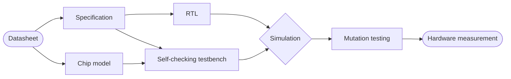

# Design and verification flow

| Part | What it is |
|---|---|
| **Specification** | The core's README: protocol, timing budget, ports and behavior, with datasheet references. |
| **Chip model** | For cores that talk to an external chip: a behavioral model written from the datasheet, with timing checks and its own testbench. It drives `'X'` while data may be changing and `'Z'` when nothing drives the line. |
| **RTL** | Synthesizable VHDL-2008, developed in small increments together with its testbench. |
| **Self-checking testbench** | Plain VHDL-2008 with random gaps, backpressure and corner cases. It checks that the expected number of results arrived, not only that no error occurred. |
| **Mutation testing** | Bugs are put into the design on purpose, and the testbench has to catch every one. See the [results for `axis_reg_slice`](../ip/axis_reg_slice/docs/testbench.md#testing-the-test). |
| **Hardware measurement** | The measured result is compared with the model and the datasheet, for example the ADC's [SNR and ENOB](../ip/pmod_ad1/docs/fft_measurement.md). |

Every push runs all testbenches in CI.
