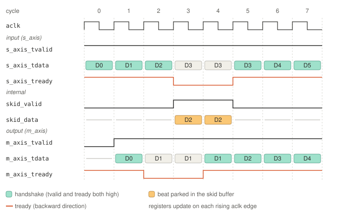

# Skid Buffer `axis_reg_slice`

An AXI4-Stream register slice: a pipeline stage that adds one flip-flop boundary in **both** directions of a stream link, at full throughput and without changing what flows through it.

Source: [`ip/axis_reg_slice/rtl/vhdl/axis_reg_slice.vhd`](rtl/vhdl/axis_reg_slice.vhd)

- Testbenches, waveforms and the bugs they catch: [docs/testbench.md](docs/testbench.md)
- The stream rules every core follows: [stream_contract.md](../../docs/stream_contract.md)
- What "beat", "frame" and "burst" mean: [axi_stream_terms.md](../../docs/axi_stream_terms.md)

## Why it exists

A stream link has signals going both ways:

- **Forward:** `tdata`, `tvalid` and `tlast` go from source to sink.
- **Backward:** `tready` goes from sink to source.

When no stage registers them, the logic of neighbouring stages chains together. The worst case is `tready`: a sink saying "stall" can ripple combinationally through every stage's `tready` logic back to the ADC within a single clock cycle. On the Zynq-7020 that long path is what fails timing once the chain grows.

Drop a register slice into any link and both directions start from a flop. When Vivado reports a failing path between two stages, inserting one of these on that link is the usual fix.

## Port naming

AXI names ports from the block's own point of view:

- **`s_axis_*`** (slave/subordinate): the **input** side. Beats arrive from the upstream block.
- **`m_axis_*`** (master/manager): the **output** side. Beats leave to the downstream block.

```
   upstream                    axis_reg_slice                  downstream
  (e.g. ADC)                                                  (e.g. filter)

   m_axis_* ────────────▶ s_axis_*        m_axis_* ────────────▶ s_axis_*
   (sends)                (receives)      (sends)                (receives)
```

| Port | Dir | Driven by | Meaning |
|---|---|---|---|
| `s_axis_tdata` | in | upstream | Incoming data |
| `s_axis_tvalid` | in | upstream | "I have a valid beat" |
| `s_axis_tlast` | in | upstream | "This is the last beat of the frame" |
| `s_axis_tready` | **out** | slice | "Send it, I can take it" |
| `m_axis_tdata` | out | slice | Outgoing data |
| `m_axis_tvalid` | out | slice | "There is a valid beat on my output" |
| `m_axis_tlast` | out | slice | `tlast` of the outgoing beat |
| `m_axis_tready` | **in** | downstream | "I can take your beat" |

`tready` always flows against the data, so `s_axis_tready` is an output and `m_axis_tready` is an input.

A beat transfers only on a rising `aclk` edge where **`tvalid` and `tready` are both high**. If either is low, nothing moves and the sender keeps holding the same beat.

## Internals

The slice holds up to two beats:

| Signals | Role |
|---|---|
| `m_valid`, `m_data`, `m_last` | **Main register.** Wired straight to `m_axis_*`; this is the beat the downstream block sees. |
| `skid_valid`, `skid_data`, `skid_last` | **Skid buffer.** Holds the one extra beat that arrives after the downstream block stalls. |

### Why a skid buffer is needed

Registering the forward signals is easy. Registering `tready` is the hard part: if `s_axis_tready` comes from a flop, it is always **one cycle late**. When the downstream block drops `m_axis_tready`, the upstream block still sees `tready = 1` for that cycle and sends one more beat. The main register is full and stalled, so that beat would be lost. The skid buffer catches it, like a car skidding a little past the stop line.

The key line is:

```vhdl
s_axis_tready <= not skid_valid;
```

`s_axis_tready` depends only on a flop, never on `m_axis_tready`. That is what cuts the backward path.

### The three cases

| Condition | What happens on the clock edge |
|---|---|
| Output empty or being taken (`m_valid = '0' or m_axis_tready = '1'`), skid **full** | Skid beat moves into the main register; skid empties. `s_axis_tready` was 0, so no new beat arrives. |
| Output empty or being taken, skid **empty** | Normal pass-through: the input goes straight into the main register. This is the steady state. |
| Output **stalled**, input beat arriving (`s_axis_tready` is still 1) | The beat is parked in the skid. Next cycle `s_axis_tready` drops to 0. |

## Timing walkthrough

The upstream block sends continuously. The downstream block stalls for cycles 2 and 3.



| Cycle | What happens |
|---|---|
| 0 | After reset both registers are empty, so `s_axis_tready = 1`. D0 is accepted and is written into the main register on the edge. |
| 1 | D0 is on the output and the downstream block is ready: D0 leaves. D1 arrives in the same cycle. One beat per cycle. |
| 2 | `m_axis_tready` drops and D1 is stuck on the output. `s_axis_tready` is still 1 because it comes from a flop, so D2 is accepted. The main register is full, so D2 goes into the skid. |
| 3 | `skid_valid = 1`, so `s_axis_tready = 0`. Upstream holds D3. Downstream is still stalled. Nothing moves. |
| 4 | Downstream is ready again: D1 leaves. D3 still waits. On the edge, D2 moves from the skid into the main register and the skid empties. |
| 5 | Skid empty, `s_axis_tready = 1`: D3 is accepted while D2 leaves. Back to normal flow. |
| 6–7 | Normal flow: D3 and D4 leave, D4 and D5 arrive. |

Reading the green beats on `m_axis_tdata` from left to right gives D0, D1, D2, D3, D4. Nothing is lost or duplicated. D1 sits on the output from cycle 2 to cycle 4 but only transfers in cycle 4, the first cycle where `tvalid` and `tready` are both high.

The testbench exercises exactly this path; see [docs/testbench.md](docs/testbench.md) for a simulation waveform of it.

## Properties

- **Throughput:** one beat per cycle while the downstream block stays ready, because the skid stays empty.
- **Latency:** one cycle.
- **Cost:** about 2 × `DATA_WIDTH` flops, plus a mux in front of the main register.
- **Reset:** only `m_valid` and `skid_valid` are reset. The data registers have no reset, which keeps the reset net's fanout small and lets the tools pack flops freely. This is safe because data is ignored while valid is low.

### Why the data registers have no reset

**Fanout** is the number of inputs one signal drives. A synchronous reset must reach every flop it drives within one clock period, just like data, so a reset net with thousands of loads becomes one of the hardest nets in the design to time.

With `DATA_WIDTH = 32`, resetting everything would put 68 flops on `aresetn`. Resetting only the valid flags puts 2 on it. One slice hardly matters, but every block in the chain shares the same reset.

On 7-series parts, the 8 flops in a slice share one clock, clock enable and set/reset (a *control set*). Flops without a reset only need to match on clock and clock enable, so Vivado can place them more freely or absorb them into DSP48, BRAM or SRL registers.

The rule of thumb: reset the control state (valids, FSM states, counters) and leave the datapath without a reset. Xilinx recommends the same in WP272, "Get Smart About Reset".
